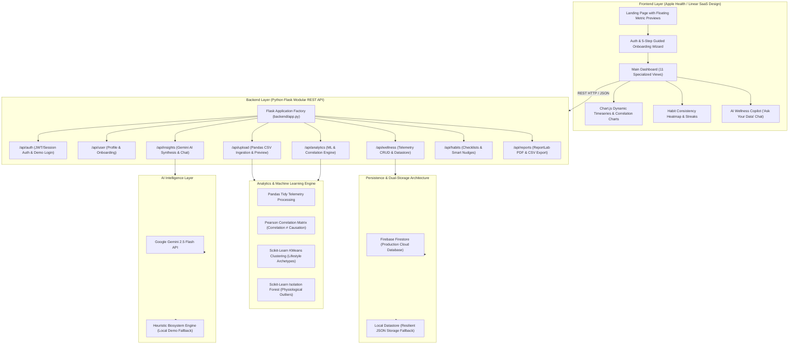

# KNOW THYSELF AI 🧠✨
### *"YOUR DATA. YOUR INTELLIGENCE."*

> **A Commercial-Grade AI Wellness Intelligence Platform for wHACKiest 2026**  
> **Developed with pride by Team CORE FOUR**

---

## 🏆 Project Vision & Context

In the modern digital lifestyle, wellness tracking is fragmented. Steps reside in fitness bands, sleep data in smart rings, and screen time on mobile operating systems. **Know Thyself AI** unites these fragmented streams into a unified personal intelligence platform.

By applying **Pandas**, **NumPy**, and **Scikit-learn** machine learning models alongside the **Google Gemini API**, Know Thyself AI discovers hidden cross-domain behavioural relationships—such as the exact statistical correlation between pre-bed digital screen exposure, sleep latency, and morning Heart Rate Variability (HRV).

> [!IMPORTANT]
> **Wellness Awareness Notice:** Know Thyself AI is an educational lifestyle awareness platform, **NOT** a medical diagnosis, clinical evaluation, or treatment application. All observations distinguish statistical correlation from clinical causation.

---

## 🏛️ System Architecture



---

## 🎨 Design System & Color Palette

Designed with inspiration from **Apple Health**, **Linear**, and **Stripe**:

- **Midnight Navy (`#101A2B`)**: Deep primary background providing high contrast and zero eye fatigue.
- **Dark Surface (`#17263B`)**: Elevated card backgrounds with subtle borders and glassmorphism.
- **Electric Teal (`#27D7C4`)**: Biological vitality, affirmative trends, and primary interactive highlights.
- **Soft White (`#F4F7FB`)**: Clean, accessible typography (*Plus Jakarta Sans* & *Outfit*).
- **AI Violet (`#9274FF`)**: Machine learning models, Google Gemini insights, and sleep stages.

---

## 🚀 Key Modules & Capabilities

### 1. Premium Landing Page
- Bold hero typography: *"Your Health Data Has a Story. Discover It."*
- Floating metric preview cards with glass effects.
- 6-feature technical architecture breakdown.
- Problem vs. Solution comparison.
- 1-Click Evaluator Demo Access.

### 2. Authentication & 5-Step Onboarding
- Registration, Login, Logout, and Password visibility toggle.
- **1-Click Hackathon Evaluator Login**: Instant access pre-loaded with 30 days of correlated telemetry.
- Multi-step onboarding wizard: Profile $\rightarrow$ Lifestyle Baseline $\rightarrow$ Wellness Priorities $\rightarrow$ Telemetry Source $\rightarrow$ Confirmation.

### 3. Unified Intelligence Dashboard (11 Views)
- **Overview**: Hero circular score (0–100), 4 KPI cards, dual primary Chart.js graphs, Pearson correlations, and KMeans lifestyle archetypes.
- **Activity & Movement**: Steps, active minutes, calories burned, and goal progression.
- **Sleep Architecture**: Deep slow-wave sleep, REM dream states, and sleep onset latency.
- **Heart Health & HRV**: Resting heart rate and Heart Rate Variability (HRV ms) autonomic tone.
- **Screen Time & Focus**: Total daily screen hours and pre-bed exposure correlation.
- **Gemini AI Insights**: 3-pillar lifestyle prescriptions with data sufficiency indicators.
- **AI Wellness Copilot**: "Ask Your Data" conversational assistant grounded in real user records.
- **Personalised Recommendations**: Actionable habit checklist with streak counters.
- **Habit Tracker**: Daily checklist, streaks, and a **28-Day Consistency Heatmap Matrix** (4 weeks $\times$ 7 days).
- **Executive Reports**: Downloadable official **ReportLab PDF** and CSV exports.
- **Data & CSV Ingestion**: Drag-and-drop CSV upload with Pandas validation, duplicate detection, and manual logging.
- **Settings & Privacy**: Profile management, notification preferences, data export, and session purging.

---

## 🧪 CSV Upload & Ingestion Engine

Test our Pandas-powered CSV ingestion using the pre-generated sample file:
1. Navigate to **Data & CSV Ingestion** from the dashboard sidebar.
2. Click **Download Sample CSV** (or use `sample_data/wellness_sample.csv`).
3. Drag and drop the CSV into the upload dropzone.
4. Review the auto-detected column mappings, valid rows, and duplicate detection diagnostics.
5. Click **Confirm & Import Telemetry** to merge the data into your live dashboard.

---

## 📄 Executive PDF Reports

Know Thyself AI compiles official wellness summaries using **ReportLab**:
- Click **Executive Reports** $\rightarrow$ **Download PDF Report**.
- Includes biometric indicator tables, cross-domain correlations, AI prescriptions, and mandatory non-clinical wellness disclaimers.

---

## ⚡ Quick Start Instructions

### 1. Prerequisites
- Python 3.10+
- Modern Web Browser (Chrome, Edge, Firefox, Safari)

### 2. Setup Environment
```bash
cd know-thyself-ai
pip install -r requirements.txt
```

### 3. Environment Variables (Optional)
```bash
# On Windows:
copy .env.example .env
# On macOS / Linux:
cp .env.example .env
```
- **Gemini API Key**: Add your `GEMINI_API_KEY` from Google AI Studio. *(If omitted, the platform automatically activates the intelligent local heuristic AI engine so all features work seamlessly offline!)*
- **Firebase Firestore**: Add your service account JSON path to `FIREBASE_CREDENTIALS_PATH`. *(If omitted, the app utilizes its built-in local datastore).*

### 4. Run the Application
```bash
python run.py
```
Open your browser at:
```
http://localhost:5000
```

---

## 📡 Complete REST API Reference

| Endpoint | Method | Description |
| :--- | :--- | :--- |
| `/api/health` | `GET` | Health check, database mode & AI engine readiness |
| `/api/auth/register` | `POST` | User registration |
| `/api/auth/login` | `POST` | User login |
| `/api/auth/demo` | `POST` | 1-click evaluator demo authentication |
| `/api/auth/me` | `GET` | Current authenticated user profile |
| `/api/user/profile` | `GET/POST` | Profile details management |
| `/api/user/onboarding` | `POST` | Multi-step onboarding results |
| `/api/user/preferences` | `GET/POST` | Notification & theme preferences |
| `/api/wellness/records` | `GET` | Retrieve recorded telemetry history |
| `/api/wellness/add` | `POST` | Log new daily telemetry entry |
| `/api/wellness/delete` | `POST` | Delete specific telemetry entry |
| `/api/wellness/reset` | `POST` | Reset datastore to pristine 30-day sample data |
| `/api/upload/preview` | `POST` | Pandas CSV preview & column mapping diagnostics |
| `/api/upload/csv` | `POST` | Ingest validated CSV rows into database |
| `/api/upload/sample-csv` | `GET` | Download sample CSV for evaluator testing |
| `/api/analytics/dashboard`| `GET` | Headline summary cards & period comparisons |
| `/api/analytics/timeseries`| `GET` | Synchronous timeseries arrays for Chart.js |
| `/api/analytics/correlations`| `GET` | Pearson correlation matrix & behavioral findings |
| `/api/analytics/clusters`| `GET` | Scikit-learn KMeans lifestyle archetypes |
| `/api/habits` | `GET` | Habits checklist, streaks & 28-day heatmap |
| `/api/habits/toggle` | `POST` | Toggle completion state of a habit |
| `/api/notifications` | `GET` | Contextual in-app smart nudges |
| `/api/insights/recommendations` | `GET` | Gemini AI lifestyle prescriptions |
| `/api/insights/chat` | `POST` | Conversational "Ask Your Data" copilot Q&A |
| `/api/reports/pdf` | `GET` | Generate and download ReportLab PDF report |
| `/api/reports/export` | `GET` | Export full raw telemetry as CSV |

---

## 🏅 Hackathon Team: CORE FOUR
- **Event:** wHACKiest 2026 Hackathon
- **Team:** CORE FOUR
- **Project:** Know Thyself AI
- **Tagline:** *YOUR DATA. YOUR INTELLIGENCE.*
